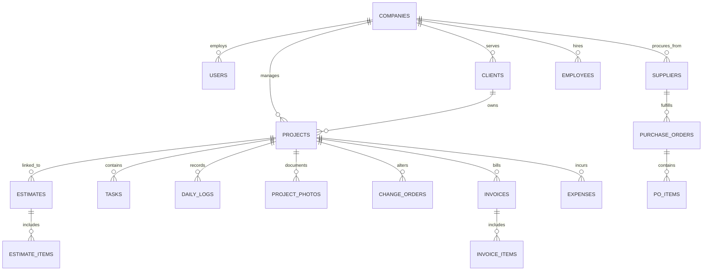

# ConstructFlow — Database Design & Schema Specification

**Version:** 2.0  
**Target Engine:** MySQL 8.0+ / InnoDB / UTF8MB4  
**Multi-Tenant Strategy:** `company_id` Foreign Key Scoping across all domain tables  

---

## 1. Entity-Relationship Overview

---

## 2. Table Schemas & Column Specifications

### 2.1 Core Multi-Tenant Tables

#### `companies` (Tenants)
| Column | Type | Constraints | Description |
| :--- | :--- | :--- | :--- |
| `id` | `BIGINT UNSIGNED` | `PRIMARY KEY, AUTO_INCREMENT` | Unique tenant ID |
| `uuid` | `CHAR(36)` | `UNIQUE, NOT NULL` | Public identifier for API/Webhooks |
| `name` | `VARCHAR(255)` | `NOT NULL` | Registered company name |
| `slug` | `VARCHAR(255)` | `UNIQUE, NOT NULL` | URL subdomain or slug |
| `logo_path` | `VARCHAR(255)` | `NULLABLE` | S3 path to company logo |
| `email` | `VARCHAR(255)` | `NOT NULL` | Primary business contact email |
| `phone` | `VARCHAR(50)` | `NULLABLE` | Contact phone number |
| `address` | `TEXT` | `NULLABLE` | Full office street address |
| `currency` | `VARCHAR(3)` | `DEFAULT 'USD'` | Primary currency code (USD, EUR, CAD) |
| `tax_number` | `VARCHAR(100)` | `NULLABLE` | EIN, VAT, or GST registration number |
| `stripe_id` | `VARCHAR(255)` | `NULLABLE, INDEX` | Stripe customer ID for billing |
| `pm_type` | `VARCHAR(255)` | `NULLABLE` | Payment method brand |
| `pm_last_four` | `VARCHAR(4)` | `NULLABLE` | Last 4 digits of card |
| `trial_ends_at` | `TIMESTAMP` | `NULLABLE` | Subscription trial expiration |
| `created_at` | `TIMESTAMP` | `NULLABLE` | Record creation date |
| `updated_at` | `TIMESTAMP` | `NULLABLE` | Record update date |
| `deleted_at` | `TIMESTAMP` | `NULLABLE` | Soft delete timestamp |

#### `users`
| Column | Type | Constraints | Description |
| :--- | :--- | :--- | :--- |
| `id` | `BIGINT UNSIGNED` | `PRIMARY KEY, AUTO_INCREMENT` | User ID |
| `company_id` | `BIGINT UNSIGNED` | `FOREIGN KEY (companies.id), NOT NULL` | Tenant isolation key |
| `name` | `VARCHAR(255)` | `NOT NULL` | Full name |
| `email` | `VARCHAR(255)` | `NOT NULL` | Login email address |
| `password` | `VARCHAR(255)` | `NOT NULL` | Encrypted password hash |
| `role` | `ENUM(...)` | `NOT NULL, DEFAULT 'staff'` | `owner`, `admin`, `pm`, `engineer`, `foreman`, `staff`, `accountant`, `client` |
| `avatar_path` | `VARCHAR(255)` | `NULLABLE` | Profile image path |
| `phone` | `VARCHAR(50)` | `NULLABLE` | Mobile number for SMS/2FA |
| `remember_token` | `VARCHAR(100)` | `NULLABLE` | Auth session token |
| `email_verified_at`| `TIMESTAMP` | `NULLABLE` | Verification timestamp |
| `created_at` | `TIMESTAMP` | `NULLABLE` | Record creation date |
| `updated_at` | `TIMESTAMP` | `NULLABLE` | Record update date |

---

### 2.2 CRM & Client Portal Tables

#### `clients`
| Column | Type | Constraints | Description |
| :--- | :--- | :--- | :--- |
| `id` | `BIGINT UNSIGNED` | `PRIMARY KEY, AUTO_INCREMENT` | Client ID |
| `company_id` | `BIGINT UNSIGNED` | `FOREIGN KEY (companies.id), NOT NULL` | Tenant isolation key |
| `type` | `ENUM('residential', 'commercial')` | `DEFAULT 'residential'` | Client category |
| `name` | `VARCHAR(255)` | `NOT NULL` | Person or business name |
| `contact_person` | `VARCHAR(255)` | `NULLABLE` | Primary representative |
| `email` | `VARCHAR(255)` | `NOT NULL` | Client email address |
| `phone` | `VARCHAR(50)` | `NULLABLE` | Contact phone |
| `address` | `TEXT` | `NULLABLE` | Billing address |
| `notes` | `TEXT` | `NULLABLE` | CRM notes |
| `created_at` | `TIMESTAMP` | `NULLABLE` | Record creation date |
| `updated_at` | `TIMESTAMP` | `NULLABLE` | Record update date |

---

### 2.3 Project Management & Field Tables

#### `projects`
| Column | Type | Constraints | Description |
| :--- | :--- | :--- | :--- |
| `id` | `BIGINT UNSIGNED` | `PRIMARY KEY, AUTO_INCREMENT` | Project ID |
| `company_id` | `BIGINT UNSIGNED` | `FOREIGN KEY (companies.id), NOT NULL` | Tenant isolation key |
| `client_id` | `BIGINT UNSIGNED` | `FOREIGN KEY (clients.id), NOT NULL` | Client relationship |
| `project_number` | `VARCHAR(50)` | `NOT NULL` | E.g. `PRJ-2026-001` |
| `name` | `VARCHAR(255)` | `NOT NULL` | Project title |
| `status` | `ENUM(...)` | `DEFAULT 'active'` | `draft`, `pending`, `active`, `on_hold`, `completed`, `archived` |
| `budget` | `DECIMAL(12,2)` | `DEFAULT 0.00` | Target project budget |
| `progress` | `TINYINT UNSIGNED` | `DEFAULT 0` | 0-100 completion percentage |
| `start_date` | `DATE` | `NULLABLE` | Planned start date |
| `end_date` | `DATE` | `NULLABLE` | Planned completion date |
| `address` | `TEXT` | `NULLABLE` | Job site physical address |
| `description` | `TEXT` | `NULLABLE` | Scope summary |
| `created_at` | `TIMESTAMP` | `NULLABLE` | Record creation date |
| `updated_at` | `TIMESTAMP` | `NULLABLE` | Record update date |

#### `daily_logs`
| Column | Type | Constraints | Description |
| :--- | :--- | :--- | :--- |
| `id` | `BIGINT UNSIGNED` | `PRIMARY KEY, AUTO_INCREMENT` | Log ID |
| `company_id` | `BIGINT UNSIGNED` | `FOREIGN KEY (companies.id), NOT NULL` | Tenant isolation key |
| `project_id` | `BIGINT UNSIGNED` | `FOREIGN KEY (projects.id), NOT NULL` | Project relationship |
| `user_id` | `BIGINT UNSIGNED` | `FOREIGN KEY (users.id), NOT NULL` | Author (Foreman) |
| `log_date` | `DATE` | `NOT NULL` | Date of field log |
| `weather` | `VARCHAR(100)` | `NULLABLE` | E.g. "Sunny, 75°F" |
| `crew_count` | `SMALLINT UNSIGNED`| `DEFAULT 0` | On-site headcount |
| `work_performed` | `TEXT` | `NOT NULL` | Detailed work narrative |
| `issues` | `TEXT` | `NULLABLE` | Delays, hazards, or site problems |
| `created_at` | `TIMESTAMP` | `NULLABLE` | Record creation date |
| `updated_at` | `TIMESTAMP` | `NULLABLE` | Record update date |

#### `project_photos`
| Column | Type | Constraints | Description |
| :--- | :--- | :--- | :--- |
| `id` | `BIGINT UNSIGNED` | `PRIMARY KEY, AUTO_INCREMENT` | Photo ID |
| `company_id` | `BIGINT UNSIGNED` | `FOREIGN KEY (companies.id), NOT NULL` | Tenant isolation key |
| `project_id` | `BIGINT UNSIGNED` | `FOREIGN KEY (projects.id), NOT NULL` | Project relationship |
| `user_id` | `BIGINT UNSIGNED` | `FOREIGN KEY (users.id), NOT NULL` | Uploader ID |
| `category` | `ENUM(...)` | `DEFAULT 'during'` | `before`, `during`, `after`, `inspection`, `safety` |
| `file_path` | `VARCHAR(255)` | `NOT NULL` | S3 image storage key |
| `caption` | `VARCHAR(255)` | `NULLABLE` | Photo description |
| `created_at` | `TIMESTAMP` | `NULLABLE` | Record creation date |

---

### 2.4 Financials & Estimates Tables

#### `estimates`
| Column | Type | Constraints | Description |
| :--- | :--- | :--- | :--- |
| `id` | `BIGINT UNSIGNED` | `PRIMARY KEY, AUTO_INCREMENT` | Estimate ID |
| `company_id` | `BIGINT UNSIGNED` | `FOREIGN KEY (companies.id), NOT NULL` | Tenant key |
| `client_id` | `BIGINT UNSIGNED` | `FOREIGN KEY (clients.id), NOT NULL` | Client target |
| `project_id` | `BIGINT UNSIGNED` | `NULLABLE` | Linked project if converted |
| `estimate_number`| `VARCHAR(50)` | `NOT NULL` | E.g. `EST-2026-101` |
| `status` | `ENUM(...)` | `DEFAULT 'draft'` | `draft`, `sent`, `approved`, `rejected`, `converted` |
| `subtotal` | `DECIMAL(12,2)` | `DEFAULT 0.00` | Before tax total |
| `tax_amount` | `DECIMAL(12,2)` | `DEFAULT 0.00` | Calculated tax |
| `total_amount` | `DECIMAL(12,2)` | `DEFAULT 0.00` | Final total quote |
| `created_at` | `TIMESTAMP` | `NULLABLE` | Creation date |

#### `change_orders`
| Column | Type | Constraints | Description |
| :--- | :--- | :--- | :--- |
| `id` | `BIGINT UNSIGNED` | `PRIMARY KEY, AUTO_INCREMENT` | CO ID |
| `company_id` | `BIGINT UNSIGNED` | `FOREIGN KEY (companies.id), NOT NULL` | Tenant key |
| `project_id` | `BIGINT UNSIGNED` | `FOREIGN KEY (projects.id), NOT NULL` | Project parent |
| `co_number` | `VARCHAR(50)` | `NOT NULL` | E.g. `CO-104` |
| `description` | `TEXT` | `NOT NULL` | Scope change summary |
| `amount` | `DECIMAL(12,2)` | `NOT NULL` | Cost modification (+/-) |
| `status` | `ENUM(...)` | `DEFAULT 'pending'` | `pending`, `approved`, `rejected` |
| `approved_at` | `TIMESTAMP` | `NULLABLE` | Approval timestamp |

#### `invoices`
| Column | Type | Constraints | Description |
| :--- | :--- | :--- | :--- |
| `id` | `BIGINT UNSIGNED` | `PRIMARY KEY, AUTO_INCREMENT` | Invoice ID |
| `company_id` | `BIGINT UNSIGNED` | `FOREIGN KEY (companies.id), NOT NULL` | Tenant key |
| `project_id` | `BIGINT UNSIGNED` | `FOREIGN KEY (projects.id), NOT NULL` | Project relationship |
| `invoice_number` | `VARCHAR(50)` | `NOT NULL` | E.g. `INV-2026-042` |
| `status` | `ENUM(...)` | `DEFAULT 'pending'` | `draft`, `pending`, `paid`, `overdue` |
| `amount` | `DECIMAL(12,2)` | `NOT NULL` | Total billed amount |
| `issue_date` | `DATE` | `NOT NULL` | Invoice date |
| `due_date` | `DATE` | `NOT NULL` | Payment due date |
| `created_at` | `TIMESTAMP` | `NULLABLE` | Creation date |

---

## 3. Indexing & Multi-Tenant Performance Rules

1. **Composite Tenant Indexes:** Every query generated by Eloquent includes `company_id`. High-throughput tables (`tasks`, `daily_logs`, `invoices`) must include composite indexes on `(company_id, status)` and `(company_id, created_at)`.
2. **Foreign Keys:** Strict `ON DELETE CASCADE` applied on secondary relationships (e.g., deleting an Estimate cascades to `estimate_items`).
3. **Soft Deletes:** Applied to `companies`, `projects`, and `clients` to preserve audit records.
