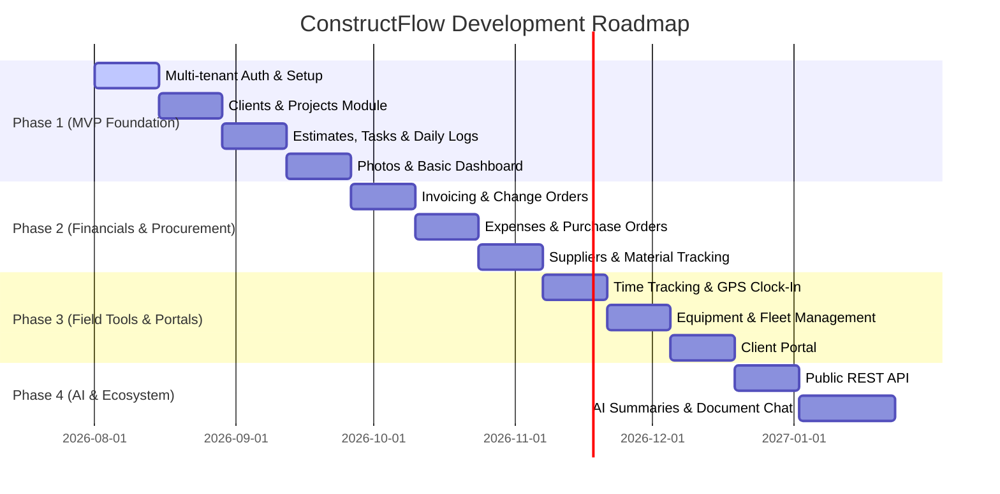

# ConstructFlow — Product Requirements Document (PRD)

**Version:** 2.0  
**Framework Target:** Laravel 13 / PHP 8.4+ / Livewire 3 & Volt / Tailwind CSS 4  
**Status:** Architecture Approved & Ready for Build  

---

## 1. Product Overview & Vision

**ConstructFlow** is an enterprise-grade, multi-tenant Construction Project Management & CRM Software-as-a-Service (SaaS). It replaces fragmented spreadsheets, messaging threads, and paper logs with a unified, real-time cloud platform tailored for small to medium-sized general contractors, specialty subcontractors, builders, and field engineers.

### Core Objectives
* **Win More Jobs:** Streamline lead tracking, estimate creation, and client quotation delivery.
* **Master Field & Office Operations:** Bridge field workers (foremen/supervisors) and office managers via real-time daily logs, change order approvals, and photo documentation.
* **Track Costs & Boost Margins:** Real-time visibility into project budgets, expenses, purchase orders, time tracking, and invoicing.
* **Strict Tenant Isolation:** Enterprise-ready multi-tenant SaaS architecture where each company operates securely with zero data cross-leakage.

---

## 2. Target Market & User Personas

### Target Sectors
* General Contractors & Commercial Builders
* Residential Home Builders & Renovation Contractors
* Specialty Subcontractors (Electrical, Plumbing, HVAC, Roofing, Masonry, Painting)
* Landscape & Civil Construction Companies
* Fit-out & Interior Contractors

### User Personas & Permissions Matrix

| Role | Description | Key Capabilities |
| :--- | :--- | :--- |
| **Owner** | Company founder/exec | Full administrative, financial, billing, and system access across all tenants. |
| **Administrator** | Operations manager | Company profile, user invitation, role management, system settings. |
| **Project Manager** | Lead project overseer | Create/manage projects, budgets, estimates, change orders, invoices, assign tasks. |
| **Engineer** | Technical field supervisor | Review designs, approve quality inspections, monitor timelines & daily logs. |
| **Foreman** | On-site crew leader | Submit daily field logs, log weather/delays, capture site photos, clock crew hours. |
| **Staff / Trades** | Field worker / Subcontractor | View assigned tasks, clock in/out, view project files. |
| **Accountant** | Financial controller | Manage invoices, expenses, purchase orders, financial reporting, payment tracking. |
| **Client** | External property owner | View project timeline, approve change orders, download files, pay invoices. |

---

## 3. Core Module Specifications

### 3.1 Company & Multi-Tenant Management
* **Multi-Tenant Foundation:** Single-database architecture with `company_id` foreign key isolation on all domain models, supported by global Eloquent tenant scopes.
* **Company Profiles:** Business registration details, logo uploads, address, default currency, tax numbers (VAT/GST/EIN), timezone, and fiscal year settings.
* **Subscription & Billing:** Integrated with Stripe via Laravel Cashier for tiered plans (Starter, Growth, Enterprise), usage limits, and automated recurring invoices.

### 3.2 Lead & Client Management (CRM)
* **Client Database:** Residential and commercial client profiles, primary contact personnel, communication logs, and active project history.
* **Lead Pipeline:** Interactive Kanban pipeline (New Lead → Initial Contact → Site Visit → Estimate Sent → Won/Lost).
* **Notes & File Attachments:** Attach blueprints, meeting notes, and client communication directly to client profiles.

### 3.3 Project Management & Field Operations
* **Project Hub:** Project code, status badges (`Draft`, `Active`, `On Hold`, `Completed`, `Archived`), budget tracking, start/end timelines, and assigned crew.
* **Progress Tracking:** Automated percentage completion calculated from task milestones and work packages.
* **Daily Logs (Field Reporting):** On-site foremen submit daily reports capturing:
  * Weather conditions (temperature, rain delays)
  * Crew count & labor hours
  * Heavy equipment usage & idle hours
  * Narrative of work performed & milestones reached
  * Safety incidents, inspections, and site issues
* **Site Photos & Gallery:** Categorized photo uploads (`Before`, `In-Progress`, `After`, `Inspection`, `Safety`) with automated JPEG compression and EXIF metadata extraction.
* **Document Repository:** Centralized storage for blueprints, CAD drawings, permits, contracts, and engineering specs backed by Amazon S3 storage.

### 3.4 Estimates & Change Orders
* **Estimate Builder:** Multi-item estimation engine with line items (materials, labor, equipment, markup percentages, tax rates, and discounts).
* **Estimate-to-Project Conversion:** 1-click transformation of approved estimates into active projects with generated task breakdowns.
* **Change Order Workflow:** Formal change order requests (`CO-101`) detailing scope change, cost impact, and timeline adjustments with formal client digital sign-off.

### 3.5 Task & Schedule Management
* **Task Board & List Views:** Kanban drag-and-drop board filtered by status (`To Do`, `In Progress`, `In Review`, `Done`), priority (`Low`, `Medium`, `High`, `Urgent`), and assigned user.
* **Milestone Dependencies:** Link tasks to project phases and track critical path bottlenecks.

### 3.6 Financials & Procurement
* **Invoicing:** Generate clean, customizable PDF invoices tied to project milestones or time-and-materials. Track status (`Draft`, `Sent`, `Partial`, `Paid`, `Overdue`).
* **Expense Tracking:** Log operational expenses with receipt photo attachments, categorized by labor, fuel, materials, equipment, and sub-contracts.
* **Purchase Orders:** Generate, approve, and track material POs dispatched to registered suppliers.
* **Supplier & Inventory Management:** Supplier directory, material price lists, stock receiving, and material allocation to projects.

### 3.7 Time Tracking & Fleet Management
* **Time Clock:** Mobile-optimized clock-in / clock-out with optional GPS geofencing and breakdown logs (work vs. breaks).
* **Equipment & Vehicle Fleet:** Inventory of heavy machinery, tools, service schedules, maintenance logs, and location tracking.

### 3.8 Client Portal
* **Restricted Client View:** Dedicated portal route where clients can view live progress updates, review site photos, download contracts, approve change orders, and settle pending invoices.

### 3.9 AI Features (Roadmap / Phase 4)
* **Daily Log Summarization:** AI-generated weekly digest for project managers.
* **Automated Material Estimation:** Predictive material requirements derived from project parameters.
* **Document Q&A:** Natural language search and Q&A over uploaded blueprints and contracts.

---

## 4. Technical & Non-Functional Requirements

### 4.1 System Requirements
* **Stack:** Laravel 13, PHP 8.4+, Livewire 3 with Volt, AlpineJS, Tailwind CSS 4.
* **Database:** MySQL 8.0+ with InnoDB and UTF8MB4 support.
* **Caching & Queues:** Redis with Laravel Horizon for background job orchestration.
* **File Storage:** Amazon S3 / S3-compatible object storage with signed temporary URLs.

### 4.2 Security & Compliance
* **Tenant Isolation:** Enforced via `BelongsToTenant` trait applying global scope `company_id = auth()->user()->company_id` on all queries.
* **Role Authorization:** Granular Policies & Gates for every model action.
* **CSRF & Rate Limiting:** Built-in Laravel CSRF protection, rate limiting on auth & API endpoints.
* **Data Encryption:** Sensitive tokens, credentials, and uploaded files encrypted at rest.

---

## 5. Development & Implementation Roadmap

